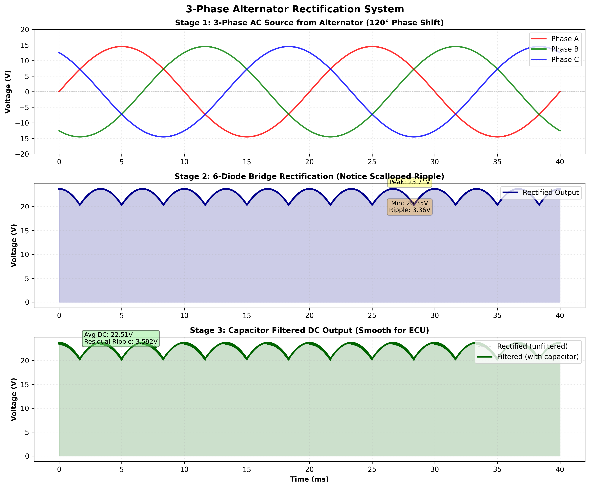
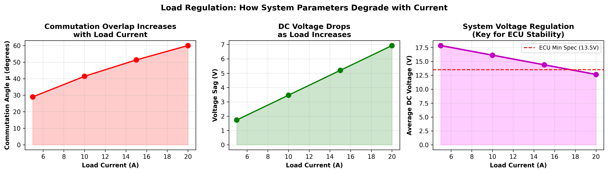

# 3-Phase Alternator Digital Twin

A Python simulation of a car alternator's charging path: three-phase generation, the six-diode bridge rectifier, commutation overlap caused by source inductance, and the capacitor filter on the DC side. It shows how DC voltage, ripple and dissipated power change with load current.



## What it models

- **Three-phase source:** three sinusoidal phases 120° apart (`core/physics_engine.py`).
- **Six-pulse rectification:** at each instant the bridge outputs the highest line-to-line voltage, minus two diode drops.
- **Commutation overlap:** the source inductance $L_c$ delays the hand-over between diode pairs. The overlap angle grows with load current $I_d$:

```math
\cos\mu = 1 - \frac{2\,\omega L_c I_d}{\sqrt{3}\,V_{peak}}
```

- **Capacitor filter:** the capacitor charges on each pulse and discharges through the load between pulses, $V_C(t) = V_0\,e^{-t/RC}$, integrated step by step (`core/filter_module.py`). The module also computes ripple and the power lost in the load and in the capacitor's ESR.
- **Scenarios and extensions** (`scenarios/`): cold start, sustained load and a full load sweep; temperature-dependent resistance, battery droop, ECU load profiles and harmonic content.

## Load regulation



| Figure | What it shows |
| --- | --- |
| [load_variation_waveforms.png](docs/load_variation_waveforms.png) | Output waveforms at 5, 10, 15 and 20 A |
| [power_dissipation.png](docs/power_dissipation.png) | Power in the load and in the capacitor ESR |
| [scenario_1_cold_start.png](docs/scenario_1_cold_start.png) | High inrush current at engine start |
| [scenario_2_sustained_load.png](docs/scenario_2_sustained_load.png) | Continuous load, such as an A/C compressor |
| [scenario_3_efficiency.png](docs/scenario_3_efficiency.png) | Behaviour across the full load range |
| [extension_1_temperature.png](docs/extension_1_temperature.png) | Temperature-dependent resistance |
| [extension_2_battery_droop.png](docs/extension_2_battery_droop.png) | Battery voltage droop |
| [extension_3_ecu_profiles.png](docs/extension_3_ecu_profiles.png) | ECU load profiles |
| [extension_4_harmonics.png](docs/extension_4_harmonics.png) | Harmonic content of the output |

## Run it

Requires Python 3 with NumPy and Matplotlib. Run the scripts from the repository root; figures are saved to `docs/`.

```bash
pip install -r requirements.txt
python run_simulation.py                 # core simulation and four figures
python validate_physics.py               # formula, trend and unit checks
python scenarios/scenario_generator.py   # operating scenarios
python scenarios/extensions.py           # extensions
```

## Default parameters

| Parameter | Value | Defined in |
| --- | --- | --- |
| Electrical frequency | 50 Hz | `AlternatorParams` |
| Phase peak voltage | 14.5 V | `AlternatorParams` |
| Source inductance $L_c$ | 1 mH | `AlternatorParams` |
| Load current | 10 A | `AlternatorParams` |
| Diode forward drop | 0.7 V | `AlternatorParams` |
| Filter capacitance | 100 µF | `FilterParams` |
| Capacitor ESR | 0.1 Ω | `FilterParams` |
| Load resistance | 14 Ω | `FilterParams` |

## Assumptions and limits

- The electrical frequency is fixed at 50 Hz. In a car it follows engine speed (pole pairs × rpm / 60), typically several hundred hertz.
- There is no voltage regulator: field current is not controlled, so the DC level follows the chosen phase peak instead of being held near 14 V.
- Phases are ideal sinusoids and each diode has a constant forward drop.
- A 100 µF capacitor alone barely smooths the ripple at 10 A. In a vehicle, the battery buffers the DC bus.

## Project layout

```text
.
├── core/
│   ├── physics_engine.py    three-phase source, rectifier, commutation
│   ├── filter_module.py     capacitor filter, ripple, dissipation
│   └── visualization.py     figures
├── scenarios/
│   ├── scenario_generator.py
│   └── extensions.py
├── docs/                    generated figures
├── run_simulation.py
├── validate_physics.py
└── requirements.txt
```

## Next steps

- Closed-loop regulation of the field current to hold the bus voltage during load steps
- Thermal model of the board, driven by the dissipation output
- A ROS 2 node that runs the model in real time
